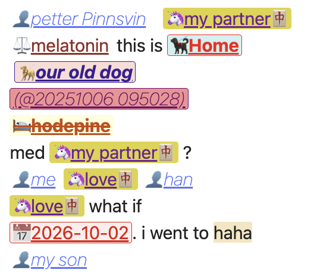
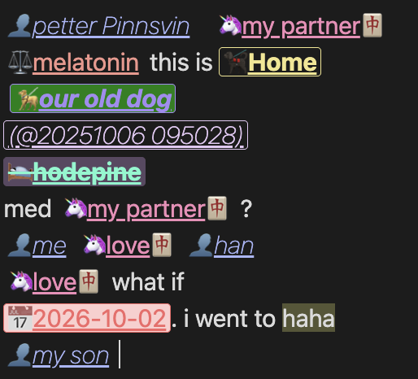
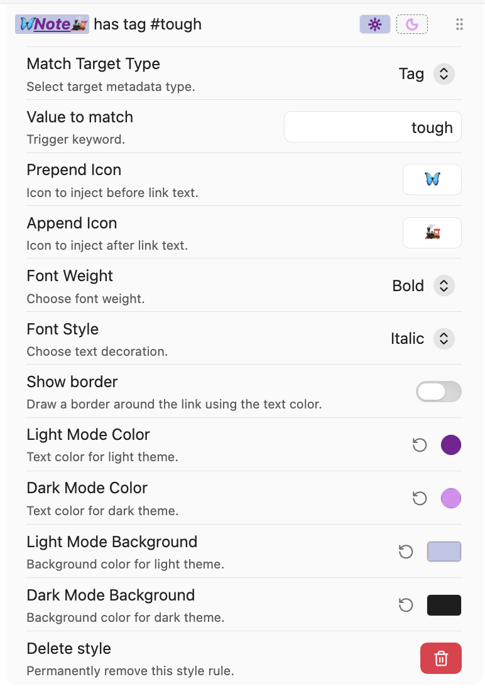
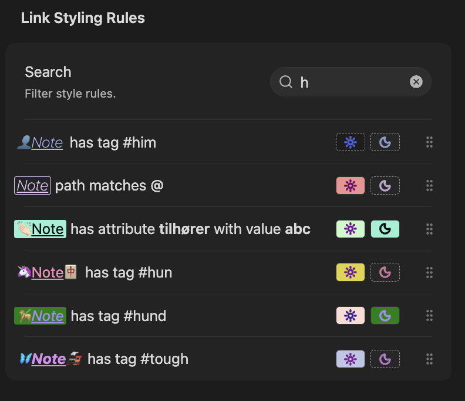

# Re-Supercharged Links

[](https://obsidian.md/plugins)
[](https://github.com/CarlB01/re-supercharged-links/releases)
[](https://github.com/CarlB01/re-supercharged-links/releases)
[](https://github.com/CarlB01/re-supercharged-links/blob/master/LICENSE)
[](https://github.com/CarlB01/myBrain)
[](https://github.com/CarlB01/re-supercharged-links/stargazers)

**Re-Supercharged Links** is a modern, high-performance Obsidian plugin that dynamically styles internal links across your entire vault based on target note metadata—including **tags**, **folder paths**, **YAML frontmatter properties**, **base views** and **Dataview inline fields**.

Whether you want to color-code project notes, prepend status icons to people and [[tasks]], or highlight specific folders at a glance, Re-Supercharged Links brings visual clarity everywhere your links appear—without slowing down large vaults.

---

## ✨ What It Styles

Links are styled consistently across almost every surface in Obsidian, including **pop-out windows**:

 

* **Editors & Views:** Live Preview styling of wiki- or markdown-style links (via CodeMirror 6 ViewPlugins) and Reading View.


* **Navigation & Sidebars:** File Explorer, Bookmarks, Starred, Search results, Backlinks, Outgoing Links, and Recent Files.
* **Popups & Switchers:** Quick Switcher (`Cmd/Ctrl + O`), `[[` link suggestion modals, and frontmatter property pills.
* **Tabs & Bases:** Workspace tab headers and Obsidian Bases / database views.
* **Third-Party Integrations:** Out-of-the-box support for Breadcrumbs, Folder Notes, Notebook Navigator, and [myBrain](https://github.com).
* **Theme-Aware Rules:** Separate color and background definitions for **Light Mode** and **Dark Mode**, plus font weight, text decorations (italic, underline, strikethrough), borders, and prefix/suffix icons/emojis (with automatic emoji deduplication).

---

## 📦 Installation

### Community Plugins (Recommended)
1. Open **Settings → Community plugins**
2. Turn off **Safe mode**
3. Select **Browse** and search for `Re-Supercharged Links`
4. Click **Install** and **Enable**

### Manual Installation
1. Download the latest asset bundle from the [Releases](https://github.com) page.
2. Extract the files into your vault's plugin directory: `.obsidian/plugins/re-supercharged-links/`
3. Reload Obsidian and enable the plugin via the settings panel.

---

**Typical Settings Panel**




---

## ⚡ Under the Hood: Built for Speed & Large Vaults

Legacy link-styling plugins often struggle in vaults with tens of thousands of notes due to repeated DOM queries, unthrottled `MutationObserver` loops, and heavy CSS snippet regeneration. **Re-Supercharged Links** was engineered from the ground up with mechanical sympathy for the V8 JavaScript engine and Chromium's rendering pipeline:

### 1. Flyweight Style Engine & Pre-Allocated Object Pools
Instead of recalculating CSS rules and allocating fresh arrays/objects for every link in your viewport, rules are atomized into lightweight integer IDs (`_flyweightIdLight` / `_flyweightIdDark`) and pre-compiled into composite classes (`scl-composite-...`). During rendering, presentation payloads reuse a **pre-allocated shared buffer pool**, eliminating garbage-collection spikes while scrolling.

### 2. Two-Tier O(1) Caching & Inverted Path Index
* **DOM Signature Barriers:** Every processed DOM node receives a compact versioned signature (`ruleVersion|matchedIds|targetPath`). If a mutation fires and the signature hasn't changed, the engine exits in **O(1)** time without touching the DOM.
* **LRU Metadata Cache with Inverted Path Indexing:** Extracted frontmatter, tags, and Dataview properties are flattened into prototype-less (`Object.create(null)`) lookup maps with a 32,768-entry LRU cache. When a file or folder is modified, renamed, or deleted, an inverted path index invalidates *only* the affected entries.

### 3. Single-Channel Mutation Batching & Multi-Window Support
Workspace mutations are routed through frame-aligned `requestAnimationFrame` batchers pinned to each element's `ownerDocument.defaultView`, ensuring smooth performance across both the main workspace and detached pop-out windows.

### 📊 Real-World Telemetry Snapshot
Built-in diagnostic commands (`Print styling performance telemetry report`) let you inspect live execution metrics in your own vault. On a stress-test session evaluating over **200,000 DOM nodes**:

```text
📊 Re-Supercharged Links Perf Report:
• Total Nodes Evaluated: 204,688
• O(1) Barrier Skip Rate: 32.4% (66,344 exits)
• Internal Cache Hit Rate: 86.5% (119,718 / 138,344)
• Frame Time (Avg / Max): 0.80ms / 2.00ms
• DOM Batches Flushed: 10 (Avg: 71,709 nodes, Last: 187,556)
```

*(Even when flushing a massive batch of **187,556 nodes**, frame execution stayed at **2.00 ms**—well inside a single 60/120 Hz display frame budget.)*

---

## 🛠️ Usage & Commands

1. Open **Settings → Re-Supercharged Links** to define rules matching **Tag**, **Attribute (Frontmatter / Dataview)**, or **Folder Path**.
2. Customize Light/Dark text colors, background colors, font weights, decorations, and before/after icons.
3. Use the Command Palette (`Cmd/Ctrl + P`) at any time to inspect performance:
   * `Re-Supercharged Links: Print styling performance telemetry report`
   * `Re-Supercharged Links: Reset styling performance telemetry metrics`

---

## 🤝 Acknowledgments & Development Note

* **Conceptual Foundation:** Inspired by the original [Supercharged Links](https://github.com) community plugin.
* **License:** Distributed under the **MIT License**. See [LICENSE](LICENSE) for details.

This plugin started as a mission to bring the beloved *Supercharged Links* workflow up to modern Obsidian standards—and quickly turned into a deep rabbit hole of V8 optimization, CodeMirror 6 internals, and multi-window DOM archaeology.

While AI sparring partners helped bounce ideas along the way, every single line of logic, edge case, cache invalidation path, and pop-out window quirk was thoroughly audited, benchmarked, and sweat-tested by hand until the frame times hit sub-millisecond averages.

If this plugin keeps your vault fast and looking sharp, you could perhaps, leave a star⭐.