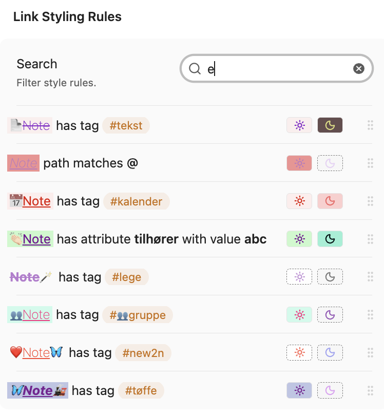
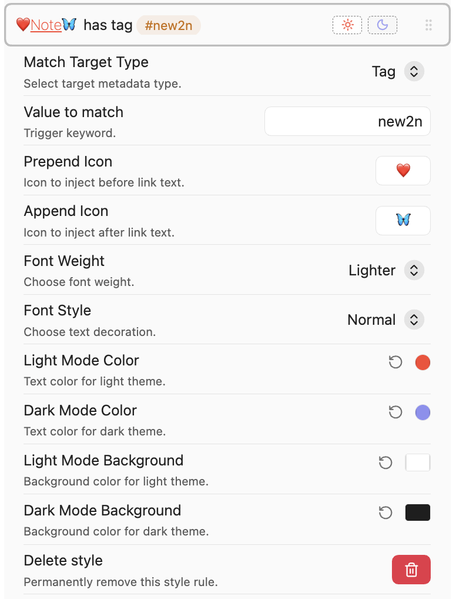

# Re-Supercharged Links

---

A fast, modern fork of **Supercharged Links** for Obsidian, rebuilt from the ground up for high-performance rendering. 

Style internal links dynamically based on tags, frontmatter attributes, inline fields, and note paths — across reading mode, live preview, and supported UI views without sacrificing your frame rate.

No magic — just a lot of engineering around keeping link styling responsive and stable.

---

## The Breakthrough (v1.1.0 Architecture)

Legacy styling approaches frequently cause micro-stuttering (*jank*) in large vaults due to continuous layout thrashing and Garbage Collection spikes. **Re-Supercharged Links** solves this by treating link styling as a high-throughput graphics pipeline.

| Architectural Feature | Legacy Supercharged Links | Re-Supercharged Links (v1.1.0) |
| :--- | :--- | :--- |
| **Styling Mechanism** | Dynamic injection of generated CSS files | In-memory evaluation mapping directly to DOM tokens |
| **DOM Mutation** | Immediate, unbatched updates per event | Asynchronous batches via `requestAnimationFrame` (`CHUNK_SIZE = 200`) |
| **Memory Management** | Heavy allocation of transient Arrays/Objects | Zero-allocation loops reusing local instanced Set pools (`.clear()`) |
| **Cache Stratification** | Naive path lookups | LRU Cache Manager with automated sub-millisecond invalidation |
| **CodeMirror Hot Path** | Full AST scan on cursor movement | Smart spatial barriers (0% CPU impact on non-link spans) |

---

**Typical Settings panel**

---

## Quick start

1. Open plugin settings.
2. Create a new styling rule.
3. Choose rule type:
   - `tag`
   - `attribute`
   - `path`
4. Set match value and styling options.
5. Navigate your vault — matching links update automatically.

---

## Technical Blueprint: Why it's faster

- **V8 JIT-Optimized Loops:** All internal iterations use traditional `for (let i = 0; i < len; i++)` and `while(i--)` constructs. Length parameters are pre-cached to allow the V8 engine to maximize Just-In-Time compilation efficiency.
- **Garbage Collection (GC) Defusal:** Avoids `Array.from().sort()` during cache eviction. Uses an inline sequential lookup on `attrCacheTouchedAt`, drastically reducing heap allocations and stabilizing frame times.
- **Batched Reflow Prevention:** Employs a custom `DOMMutationBatcher`. Instead of triggering multiple recalculate-layout cycles, changes are queued and flushed smoothly in synchronization with your monitor's refresh rate.

---

## Real-World Telemetry (v1.1.0 Profiles)

Below are real benchmark profiles taken from extensive testing in a massive production vault.

### Test 1: Aggressive Scrolling in Obsidian Core (`.base`)
*Continuous rapid scrolling through dense markdown structures.*
- **Total Operations Evaluated:** 69,363 operations
- **Cache Hit Rate:** 69.6% (48,258 hits)
- **Canonical Integrity:** 100% Canonical Migrated / **0 Legacy Fallbacks**
- **Avg Execution Frame Time:** **0.36 ms** ⚡
- **Avg Nodes Styled per Batch:** 28 nodes

### Test 2: Dynamic Dataview Stress Test
*Heavy infinite-scroll simulation inside highly volatile, auto-rendering Dataview tables.*
- **Total Operations Evaluated:** 195,739 operations
- **Cache Hit Rate:** 56.9% (111,385 hits - *lower due to dynamic DOM reconstruction*)
- **Canonical Integrity:** 100% Canonical Migrated / **0 Legacy Fallbacks**
- **Avg Execution Frame Time:** **0.30 ms** 🚀 (*Micro-barriers skipping non-target spans instantly*)
- **Avg Nodes Styled per Batch:** 4 nodes (*Progressive, ultra-lightweight DOM paint*)

### Test 3: Normal Document Navigation & Editing (Real-World Use)
*Standard real-world workflow consisting of typical scrolling, typing, and jumping between linked notes.*
- **Total Operations Evaluated:** 38,930 operations
- **Cache Hit Rate:** **93.4%** 🎯 (36,372 hits - *proving optimal LRU cache stability*)
- **Canonical Integrity:** 100% Canonical Migrated / **0 Legacy Fallbacks**
- **Avg Execution Frame Time:** **0.80 ms** 🪵 (*Slightly higher due to performing larger batch updates*)
- **Avg Nodes Styled per Batch:** 51 nodes (*Peak burst efficiency at 81 nodes without frame drops*)

---

## Features

- **Tag Rules:** Match and style links by target note tags (e.g., `#project`, `#todo`).
- **Attribute Rules:** Target frontmatter keys/values and Dataview inline fields.
- **Path Rules:** Apply structural styling matching explicit note folders and path prefixes.
- **Granular Aesthetics:** Control text colors, background colors, font weights, and custom prefix/suffix icons independently for light and dark modes.
- **Comprehensive View Coverage:** Seamless styling across Reading Mode, Live Preview (CodeMirror 6), File Explorer, Backlinks, and Search panes.

---

## Installation

### Community Plugins (Recommended)
1. Open **Settings → Community plugins**
2. Turn off **Safe mode**
3. Select **Browse** and search for `Re-Supercharged Links`
4. Click **Install** and **Enable**

### Manual Installation
1. Download the latest asset bundle from the [Releases](https://github.com) page.
2. Extract the files into your vault's plugin directory: `.obsidian/plugins/re-supercharged-links/`
3. Reload Obsidian and enable the plugin via the settings panel.

---

## Performance Tuning Tips

While v1.1.0 is engineered for extreme efficiency, overall performance can be influenced by your environment:
- If you run multiple complex UI-heavy plugins alongside massive Dataview arrays, keeping your rule conditions highly specific will yield the best results.
- If you notice unexpected rendering delays, please open an issue containing your approximate vault size, active theme, and a performance profile capture if possible.

---

## Credits & License

- Conceptual foundation inspired by the original **Supercharged Links** community project.
- Licensed under the **MIT License** — see [LICENSE](https://github.com)